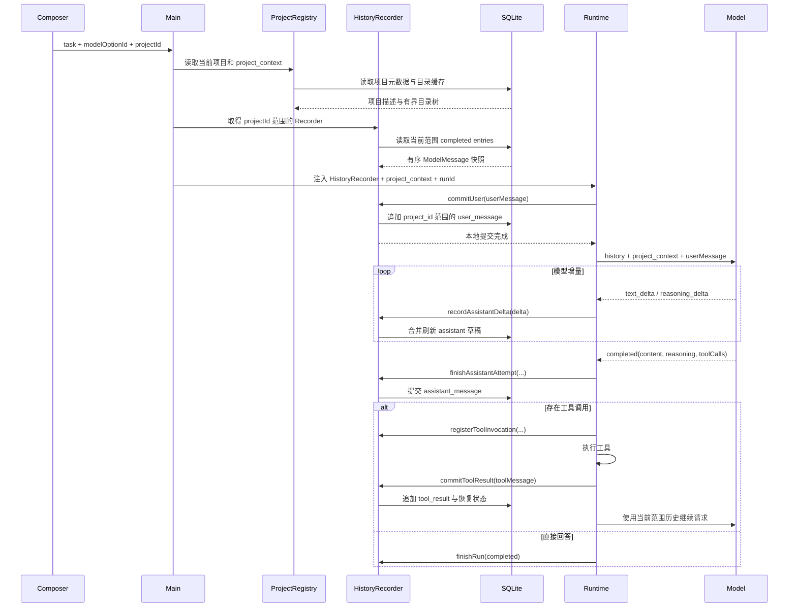
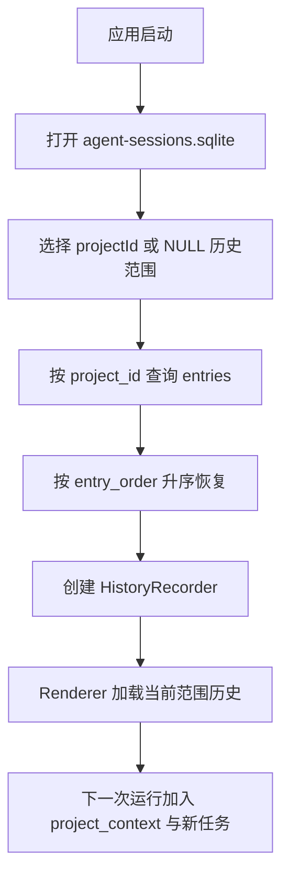

这组流程描述项目历史和无项目历史的统一提交边界。`projectId` 为真实项目 ID 时，消息归入该项目；`projectId = NULL` 时，消息归入无项目历史。

## 参与者职责

- Electron Main 打开 `userData/agent-sessions.sqlite`，维护项目注册表和项目上下文缓存。
- AgentRunner 为每次用户提交创建 `runId`，捕获 `projectId`、`cwd`、HistoryRecorder 和瞬时项目上下文。
- Runtime Loop 控制用户消息、助手消息和工具结果的提交顺序。
- HistoryRecorder 维护已完成消息快照、流式助手草稿、工具恢复账本和串行 SQLite 写入队列。
- SQLite 保存 `projects`、`project_context`、`entries` 和 `tool_invocations`。
- Renderer 接收 AgentEvent、项目切换结果和历史分页结果。

## 单次运行流程

## 历史恢复流程

历史快照只包含已完成的用户消息、助手消息和工具结果。流式记录在恢复时继续保留已写入内容，并由 Recorder 处理终态。

## 项目上下文流程

- 项目首次激活时，Main 扫描有限目录结构并写入 `project_context`。
- 缓存保持 clean 时，下一次运行直接读取缓存。
- 工具写入项目文件后，Main 将缓存标记为 dirty。
- 下一次运行刷新缓存，并以相同的有界格式把目录树加入模型请求。
- 项目上下文作为 transient ModelMessage 进入 Runtime，entries 保存用户与模型事实。
- 无项目历史拥有独立的 `NULL` 范围，并使用历史和当前任务构造模型请求。
