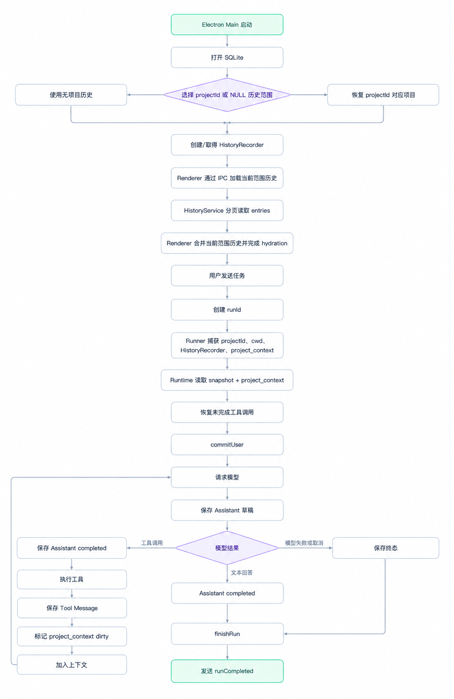

项目历史存储流程。

- 范围：`projectId` 为真实项目 ID 时，消息归入对应项目；`projectId = NULL` 时，消息归入 General 历史，两者沿用相同提交边界。
- 流程图：

参与者职责。

- Electron Main：打开 `userData/agent-sessions.sqlite`，维护项目注册表和项目上下文缓存。
- AgentRunner：为用户提交创建 `runId`，捕获 `projectId`、`cwd`、HistoryRecorder 和本轮项目上下文。
- Runtime Loop：控制用户消息、助手消息和工具结果的提交顺序。
- HistoryRecorder：维护已完成消息快照、流式助手草稿、工具恢复账本和串行 SQLite 写入队列。
- SQLite：保存 `projects`、`project_context`、`entries`、`tool_invocations` 及相关持久化事实。
- Renderer：接收 AgentEvent、项目切换结果和历史分页结果。

单次运行。

- 接收：Composer 将 task、`modelOptionId` 和 `projectId` 提交给 Main；Main 通过 ProjectRegistry 读取项目元数据与 `project_context` 有界目录树。
- 历史：Main 取得对应范围的 HistoryRecorder，Recorder 从 SQLite 读取有序记录并形成 completed ModelMessage 快照。
- 注入：Main 将 HistoryRecorder、本轮项目上下文与 `runId` 交给 Runtime。
- 用户提交：Runtime 调用 `commitUser(userMessage)`，Recorder 在 `project_id` 范围追加 `user_message`；本地提交完成后，Runtime 将历史、本轮材料和用户消息交给模型。
- 响应解析：Adapter 按[模型请求](./model-request.mdx)分离原生 `content`、原始 reasoning 与结构化 `tool_calls`；同一 turn 的 content 提供公开文字，系统提示词引导其跟随用户语言，原始 reasoning 按原文交给存储与协议续轮。
- 增量：Adapter 返回 `text_delta` 与 `reasoning_delta`，Runtime 通过 `recordAssistantDelta(kind, delta, context)` 维护正文与原始思考草稿，Recorder 合并刷新到 SQLite；正文经既有回调与 IPC `assistantDelta` 进入 `TurnState.assistantContent`，活跃组在最终身份确认前将正文暂存在活动详情。
- 完整响应：模型返回原生 content、reasoning 和 toolCalls，Runtime 分类后调用 `finishAssistantAttempt(...)`；普通答案与空计划提交，工具调用响应与整批 planned invocation 共同提交。`assistantCompleted` 对齐完整正文与调用，旧 `progress` 保留可选兼容读取，既有 JSON payload 与数据库结构继续承载完整消息。
- 工具续轮：Runtime 按登记顺序执行工具，调用 `commitToolResult(toolMessage)` 将 Tool Message 与恢复状态共同保存，整批结果提交后使用当前范围的上下文继续请求模型。
- 直接回答：回答提交后检查运行中输入，队列清空时通过 `finishRun(completed)` 完成运行；成功 `runCompleted.finalTurnId` 确认最终回答，Renderer 收起外层活动并把对应正文移到折叠外。新输入按既有安全边界进入下一轮。
- 请求与续轮：公开说明来自主模型原生 content，Provider serializer 按原生协议回放已提交正文、工具调用和 Tool Message，DeepSeek 工具续轮按协议回传原始 reasoning；输入预算按实际序列化文本计量，独立摘要请求继续服务既有上下文压缩流程。
- 展示顺序：实时与历史共用活动投影，按 turn 呈现文字、一个完整工具组、下一段文字，空工具回合直接接续文字。已应用 steer 启动下一组后，前组最后一个已提交的无工具有效回答继续位于折叠外并参与搜索，活跃组沿用最终身份确认规则。工具组标题与操作行使用实际 command、path 及工具类别，详情由各行独立展开并惰性挂载。
- 展开交互：Renderer 复用运行、回合、工具状态及最终回合身份派生默认展开值；等待执行与执行中的调用共用 `running`，结算后为 `completed`。当前工作组默认展开，所属 run 与 turn 处于运行态且任一工具为 `running` 时工具组默认展开，工具全部结算或 turn、run 终态时工具组默认收起。手动覆盖在当前工作或结算阶段生效，阶段变化恢复默认值；工具列表使用320px最大高度与内部滚动，外层活动区按内容自然增长。
- 登记接口：单调用登记接口 `registerToolInvocation(...)` 与整批登记共同遵循[工具执行恢复](./tools/recovery.mdx)的身份和事务契约。

历史恢复。

- 启动：应用打开 `agent-sessions.sqlite`，选定项目或 `NULL` 历史范围，按 `project_id` 查询 entries，再按 `entry_order` 恢复稳定顺序。
- Recorder：读取对应范围的历史记录并处理流式记录终态，模型快照包含已完成的用户消息、助手消息和工具结果，原始流式内容继续保存在历史中。
- 页面：Renderer 分页加载当前范围历史，将 `payload.content` 恢复为 `TurnState.assistantContent`，旧 `payload.progress` 兼容恢复为 `progressContent`，原始 reasoning 恢复到独立字段；最终 Assistant entry 的 `turnId` 与 `durationMs` 恢复最终回答身份。下一次运行加入当前项目地图与新任务，工具恢复按执行账本结算开放调用；活动可见性、宽度省略与阶段折叠由[消息流](../desktop/design/workbench/message-stream.mdx)统一定义。

项目上下文。

- 首次激活：Main 扫描有限目录结构并保存 `project_context`。
- 复用：缓存处于 clean 状态时，下一次运行直接使用已有目录树。
- 更新：工具写入项目文件后，Main 将缓存标记为 dirty，下一次运行刷新缓存并按相同有界格式加入模型请求。
- 来源：项目上下文作为 transient ModelMessage 进入 Runtime，entries 继续保存用户与模型的对话事实。
- General：使用独立的 `NULL` 范围，历史、默认工作目录和当前任务共同构造模型输入。
