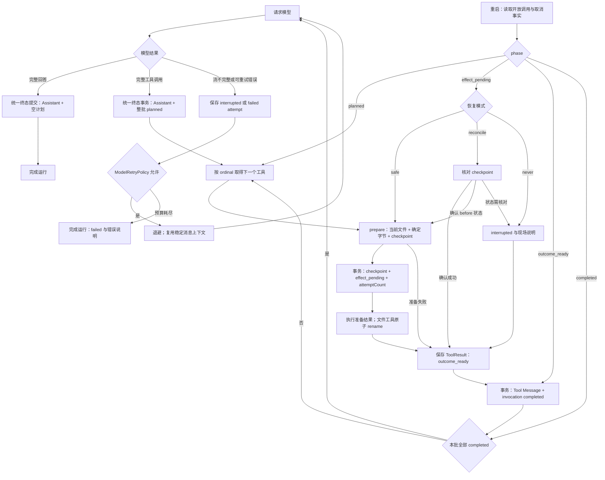

Runtime 统一调度模型请求、工具执行和重启恢复。工具注册表提供执行与恢复能力，Recorder 管理串行提交和已提交消息快照，Repository 使用 SQLite 事务保存执行事实。

## 两个原子提交边界

1. **执行前：Assistant 终态与整批计划。** `finishAssistantAttempt()` 接收消息与可选整批计划，Repository 的 `commitAssistantAttempt()` 在同一事务中提交 Assistant 与全部 `planned` invocation。普通回答使用空计划。
2. **执行后：Tool Message 与单个调用完成。** `commitToolResult()` 在同一事务中保存 `entries.tool_result` 与该 invocation 的 `completed`。每个工具独立完成提交，后续工具按原始顺序继续执行。

`entries` 保存模型可见消息；`tool_invocations` 保存执行控制事实。`assistantEntryId` 与 `ordinal` 组织模型返回的原始批次，每个逻辑调用以 `(runId, toolCallId)` 识别。

## 调用记录

| 字段 | 用途 |
| --- | --- |
| `id` | 后端调用记录的稳定身份。 |
| `projectId`、`runId`、`turnId`、`cwd` | 保存项目范围、运行、模型回合与原执行目录。 |
| `assistantEntryId`、`ordinal` | 关联产生调用的 Assistant，保留批次顺序。 |
| `toolCallId`、`toolName`、`toolVersion` | 保存逻辑调用身份、工具名称和登记版本。 |
| `inputJson`、`inputHash` | 保存标准化参数与工具名称、版本、参数的指纹，验证幂等身份的一致性。 |
| `phase` | 保存 `planned`、`effect_pending`、`outcome_ready` 或 `completed`。 |
| `outcomeStatus`、`outcomeJson` | 保存 `succeeded`、`failed`、`cancelled` 或 `interrupted` 及完整 ToolResult。 |
| `recoveryModeSnapshot` | 保存调用登记时的 `safe`、`reconcile` 或 `never` 能力快照。 |
| `attemptCount` | 保存已登记的真实执行尝试数，进入 `effect_pending` 时递增。 |
| `checkpoint` | 保存当前 attempt 的版本化恢复证据。 |
| `resultEntryId` | 预留最终 Tool Message 的稳定身份。 |
| `createdAt`、`updatedAt` | 表达调用记录的创建与控制状态更新时间。 |

## 阶段与恢复动作

| 阶段 | 持久化事实 | Runtime 动作 |
| --- | --- | --- |
| `planned` | 整批调用已登记，工具等待执行。 | 检查取消与工具跨 run 调度契约，准备本次尝试并执行，或结算取消、准备失败与跳过结果。 |
| `effect_pending` | 执行意图、attempt 与 checkpoint 已保存，副作用可能发生。 | 根据恢复快照安全重放、核对真实状态，或结算带现场说明的 interrupted 结果。 |
| `outcome_ready` | 确定的 ToolResult 已保存。 | 复用结果，在一个事务中物化 Tool Message 与 completed。 |
| `completed` | 真实 Tool Message 与完成标记共同保存。 | 复用已提交消息进入模型上下文。 |

准备失败通过 `settleUnstartedToolInvocation()` 从 `planned` 直接进入 `outcome_ready`，尝试数保持零。工具已进入尝试后，结果通过 `saveToolOutcome()` 保存。结果提交失败保留原结果和消息身份，后续恢复继续物化。

## checkpoint：每次尝试的恢复证据

checkpoint 在工具真正轮到执行时生成。`RegisteredTool.prepare(input, context)` 返回一个绑定 checkpoint 与执行闭包的准备结果。Write/Edit 读取当前文件一次，校验参数与 Edit 匹配，计算最终字节，再从同一份准备结果执行。

checkpoint 表达本次尝试的前后状态和发布身份：

- `beforeHash`：修改前文件的 SHA-256；创建文件时使用 `null`。
- `afterHash`：准备结果中完整目标字节的 SHA-256。
- `path`、`targetPath`：用户调用路径与符号链接解析后的发布目标。
- `before`、`afterMode`：原文件身份、时间、大小与权限，以及目标权限。
- `staging`：本次 invocation、attempt、随机 token 与唯一临时文件名。
- `directoryBoundary`：准备时已存在的祖先目录身份，用于确认新建目录链的持久化。
- `operation`、`byteSize`、`mediaType`：恢复结果的文件产物信息。

恢复证据采用 `version: 2`、`kind: "text_file"`。恢复器同时解析已有 version 1 的 hash 证据，并根据可验证事实给出结论。准备过程只持有内存数据，临时文件创建属于已经登记执行意图后的执行阶段。

同一批中的 A 修改文件后，B 的准备读取 A 发布后的内容；B 的 checkpoint 和实际执行始终基于同一份文件与目标字节。

## Write/Edit 的原子发布

```text
读取当前文件，准备完整目标字节与 checkpoint
  ↓
事务保存 checkpoint + effect_pending + attemptCount
  ↓
在目标同目录独占创建本次 staging 文件
  ↓
写入完整字节，保存权限，fsync，关闭文件
  ↓
核对原文件、符号链接目标、发布目录与 staging 身份
  ↓
rename：将 staging 一次性替换为目标文件
  ↓
fsync 发布目录，确认工具结果
```

rename 是文件可见内容的发布点。发布前读取目标得到旧内容，发布后读取目标得到完整新内容。同目录 staging 使发布使用同一文件系统的 rename 操作；文件 fsync 确认写入，目录 fsync 确认名称替换的持久化。

SQLite 和文件系统分别拥有提交边界。文件已经 rename、结果尚待保存的中断窗口，由 checkpoint 桥接：目标符合 after 状态时同步目标文件及目录链，再确认成功；目标符合 before 状态时允许新尝试，其余状态保存 interrupted 与核对说明。新建目录的同步按子目录到既有祖先的顺序确认各层目录入口，发布与恢复共用这一屏障。

文件发布队列按真实目标路径串行化本进程参与者，发布前再次核对来源。外部编辑造成的状态变化返回冲突；符号链接沿用真实目标，单链接普通文件使用原权限与所有者。恢复清理核对精确 staging 身份、字节与元数据，并保持现场证据可追溯。

## 注册工具的恢复能力

| 模式 | 工具能力 | effect_pending 恢复 |
| --- | --- | --- |
| `safe` | 同一参数的再次执行具有安全语义。 | 同一 invocation 开始新的 attempt。Read、Query 使用该模式。 |
| `reconcile` | 工具可解释 checkpoint 并核对实际状态。 | 返回确认成功、允许重试或 interrupted。Write、Edit 使用该模式。 |
| `never` | 工具将未知副作用交给后续独立处理。 | 保存 interrupted Tool Message 与现场说明。任意 Bash 使用该模式。 |

`recovery.version` 确定恢复实现版本，`resumePlanned` 确定前次 run 的待执行调用能否继续。Canvas Edit 使用 `resumePlanned: false`，旧调用直接结算 interrupted，新请求使用当前引用。

## 完整链路



恢复分支在调用调度与核对前检查持久化取消事实。Main 将 Stop 写入 `run_cancellations` 后触发 AbortSignal；`beginToolAttempt` 在事务中再次检查取消屏障。尚待执行的调用结算 cancelled，结果未知的已开始调用保留 checkpoint 并结算 interrupted，已知 outcome 继续物化。

在线执行与重启恢复共用持久化的批次推进规则：后序 planned 调用读取同批前序的 outcome，前序 interrupted 时结算带跳过原因的 interrupted，尝试数保持零。前序已经 completed 的 interrupted 结果继续参与此判断。`beginToolAttempt` 的事务再次核对前序结果与取消屏障，确保执行许可沿用同一规则。已确定的业务失败保存为 failed Tool Message，串行链路继续后续调用。整批结果配对完成后，Runtime 把完整上下文交给模型。

恢复调度通过 `getToolInvocationCall()` 验证 input JSON、参数指纹及源 Assistant 的范围、回合、ordinal 和工具参数。现有账本的规范化 JSON 原文提供历史指纹核对，新的指纹使用确定性键序。损坏记录通过明确存储错误报告，开放阶段保留现场；取消屏障拒绝使用独立调度类型进入 cancelled 结算。

## 三种重试边界

| 情况 | 决策者与记录 | 执行动作 |
| --- | --- | --- |
| 模型请求失败 | Runtime 的 `ModelRetryPolicy` 与 Assistant attempt。 | 按次数、退避和错误类型重新请求模型，复用最后的稳定上下文。 |
| 完整响应或工具结果保存失败 | Runtime 的 `commitRetry` 与稳定消息身份。 | 仅重提保存操作，复用同一响应、ToolResult、entryId 与时间。 |
| 重启后遗留 effect_pending | Runtime 与工具恢复能力快照。 | 安全重放、实际状态核对，或保存 interrupted 说明。 |
| 模型看到失败后重新调用 | 新的逻辑 ToolCall 与 invocation。 | 登记新的调用并按正常尝试链路执行。 |

工具在线返回的失败作为 ToolResult 进入结果链路。物理工具执行、模型请求重试和结果保存重试分别使用各自边界，Runtime 保持唯一调度入口。

## 一致性与验证

- Assistant 终态和整批 planned 共同提交或共同回滚。
- 每次执行使用对应 attempt 的 checkpoint 与已准备字节。
- 持久化错误进入存储错误路径，开放调用继续保留真实执行阶段。
- Tool Message 与 completed 共同提交或共同回滚，outcome_ready 为补交提供确定结果。
- Recorder 快照和 toolCompleted 事件在数据库提交成功后发布。
- JSON 比较遵循实际序列化语义，消息、结果和 checkpoint 在边界处验证类型与版本。
- SQLite BEGIN/COMMIT 锁冲突、延迟草稿刷新、同文件连续 Edit、rename 后结果保存中断、取消、staging 身份与历史结果投影均有回归覆盖。
